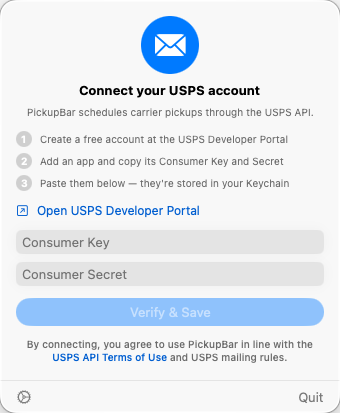
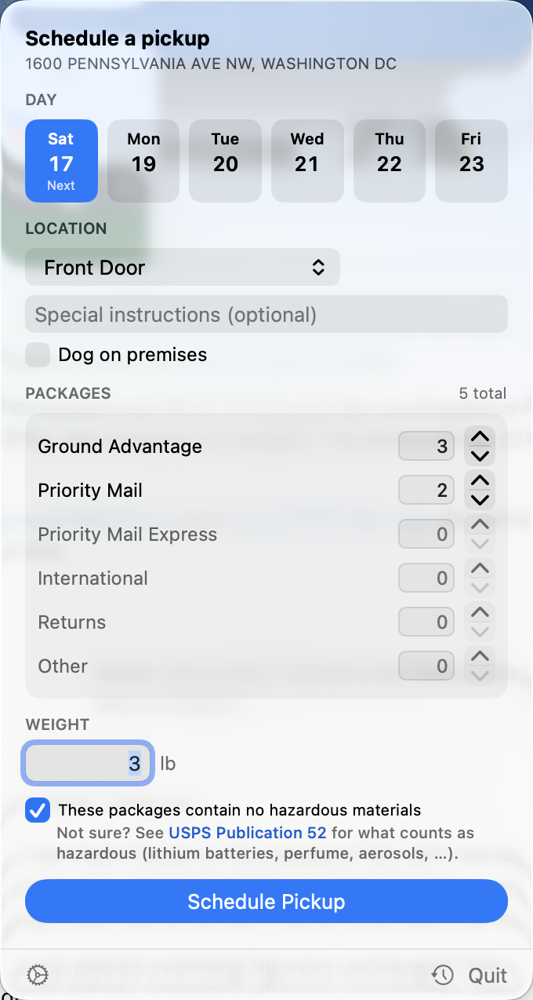
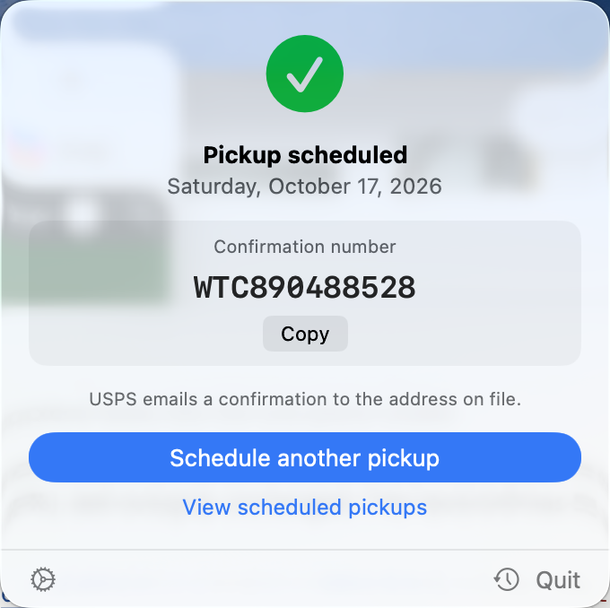
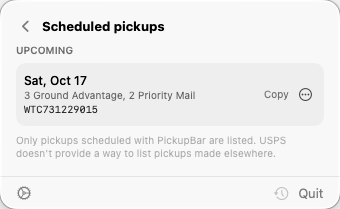

# PickupBar

[](https://github.com/toddanglin/usps-pickup-scheduler/actions/workflows/ci.yml)

A simple and easy-to-use macOS menu bar utility for quickly scheduling USPS pickups.

usps.com makes you re-login and re-enter your address practically every time
you want a package picked up. PickupBar lives in your menu bar, remembers your
verified pickup address, and schedules a pickup against the official USPS API
using your own USPS developer credentials — no browser, no re-login.

**Status:** v1.0 — in daily use by the author; API coverage verified against
the USPS test environment.

## Quick look


Prefer a sharper version? [Watch the 55-second explainer (MP4)](docs/explainer.mp4)

## Screenshots

| Onboarding | Schedule a pickup | Confirmation | Scheduled pickups |
|---|---|---|---|
|  |  |  |  |

## Features

- Lives only in the menu bar — no Dock icon, no main window
- One-time USPS credential setup, stored securely in the Keychain
- Verified default pickup address (checked against USPS eligibility)
- Next-6-days date picker that skips Sundays and USPS holidays, and honors
  the 2 AM Central same-day cutoff
- Package counts per service type (Ground Advantage, Priority Mail, Priority
  Mail Express, International, Returns, Other) — type a number or use the
  stepper — plus estimated weight, special instructions, and a "dog on
  premises" flag
- Pickup locations: Front Door, Back Door, Side Door, Knock on Door / Ring
  Bell, Mail Room, Office, Porch, Reception, Mailbox, or Other (Other needs
  special instructions)
- Required hazmat attestation before scheduling, with a link to USPS
  Publication 52
- Progress indicator and a confirmation screen with a copyable confirmation
  number
- "Scheduled pickups": a history of the pickups you scheduled with PickupBar,
  split into upcoming and past, with copyable confirmation numbers. The USPS
  API has no way to list pickups, so this is PickupBar's own local record;
  pickups made on usps.com do not appear
- Modify or cancel an upcoming pickup from that list: **Modify…** reopens the
  form filled in with the pickup as USPS has it (day, location, instructions,
  counts, weight) and saves it back; **Cancel pickup…** asks first, then
  cancels it with USPS. Cancelled pickups move to "Past" with a "Cancelled"
  badge
- Friendly, specific error messages with a "Copy details" button for bug
  reports
- Menu bar badge and a notification if your credentials stop working
- Launch at login
- Optional USPS test environment (TEM) for safe experimentation

## How it authenticates

USPS's APIs authenticate *apps*, not individual consumers — there is no
"Sign in with USPS" flow available to a desktop tool like this one. Instead,
you create a free USPS developer account and register an app, and PickupBar
uses that app's Consumer Key and Secret to request an OAuth access token
directly from USPS.

Tokens last about 8 hours and PickupBar refreshes them automatically in the
background, so you never see a login screen after the initial setup. Nothing
leaves your Mac except calls to `apis.usps.com` (or `apis-tem.usps.com` in
test mode) — your credentials are stored in the Keychain, and PickupBar sends
no telemetry or analytics anywhere.

## USPS setup

1. Go to <https://developers.usps.com> and sign up. This creates a free USPS
   business/developer account.
2. Click "Add App" to register a new application.
3. Copy the app's **Consumer Key** and **Consumer Secret** — you'll paste
   both into PickupBar's onboarding screen.
4. **Add the Carrier Pickup API product to the app** — PickupBar needs the
   Carrier Pickup product (OAuth scope `carrier-pickup`). This step is easy to
   miss: a brand-new app is created with only **Default Access**, which does
   *not* include Carrier Pickup. Open the app in the portal and add the
   **Carrier Pickup** API product (OAuth scope `carrier-pickup`) — or, if the portal won't let you, ask USPS
   to enable it through the API service-request form at
   <https://emailus.usps.com/s/usps-APIs>.

   Without it the credentials still work (the token call succeeds), but every
   pickup call comes back `401 Insufficient OAuth scope` and PickupBar shows
   "Your USPS app can't access Carrier Pickup". Settings › Account shows
   whether the token carries the `carrier-pickup` scope under **API access**.

Keep in mind USPS only allows same-day pickup requests until **2:00 AM
Central time** — after that, the earliest available day moves to the next
one.

## Install / build

**Requirements:** macOS 14+, Xcode 16+ (this repo is built and tested with
Xcode 26; CI uses Xcode 16). [XcodeGen](https://github.com/yonaskolb/XcodeGen) generates the
Xcode project: `brew install xcodegen`.

```sh
make generate   # generate PickupBar.xcodeproj with XcodeGen
make build      # debug build
make run        # build and launch
make release    # release build; app lands in .build/dd/Build/Products/Release/PickupBar.app
make test       # run the unit test suite
make icon       # regenerate AppIcon.icns from Scripts/make-icon.swift
make explainer  # re-render docs/explainer.mp4/.gif (needs `make uitest CLEAN=1 UISCREENS=.build/explainer-screens` first)
```

Release builds are ad-hoc signed, not notarized. On first launch, macOS
Gatekeeper may block the app — right-click the app and choose **Open**, or
remove the quarantine flag from Terminal:

```sh
xattr -d com.apple.quarantine /path/to/PickupBar.app
```

Then drag `PickupBar.app` to `/Applications`.

## Using it

**First run:**
- Open the USPS Developer Portal, create an app, and paste its Consumer Key
  and Secret into PickupBar — it verifies them by requesting a token
- Enter your pickup contact and address — an email (recommended: USPS sends
  the pickup confirmation there), a 10-digit cell phone, or both — and
  PickupBar validates it against
  USPS's eligibility check and stores the standardized version
- You land on the pickup form, ready to schedule

**Scheduling a pickup:**
- Pick one of the next six available pickup days
- Set your package counts by service type, pickup location, weight, and any
  special instructions, then confirm the hazmat attestation
- Tap **Schedule Pickup** and get a confirmation number you can copy
- Open **Scheduled pickups** (the clock in the footer, "View scheduled
  pickups" on the confirmation, or the "Last pickup" line on the form) to see
  every pickup PickupBar has scheduled

**Changing or cancelling a pickup:**
- In **Scheduled pickups**, open an upcoming pickup's **⋯** menu (or
  right-click the row)
- **Modify…** loads the pickup from USPS into the form; change what you need,
  re-confirm the hazmat attestation and tap **Save Changes** (or **Discard**).
  USPS keeps the same confirmation number
- **Cancel pickup…** asks for confirmation, then cancels it with USPS. If USPS
  says it was already cancelled, PickupBar just marks it cancelled
- Past and cancelled pickups can only be copied or removed from the list

**What PickupBar does not check for you:** the hazmat checkbox is only a
reminder — the USPS API has no hazmat, terms-acceptance, or business-address
fields, so those acknowledgements are your responsibility exactly as on
usps.com. Timed, paid Pickup On Demand is website-only and not supported.

**Settings tabs:**
- **Account** — masked credentials, connection status, replace/remove, and
  the USPS test environment (TEM) toggle
- **Address** — edit and re-validate your pickup contact and address
- **Defaults** — default pickup location, special instructions, dog-present
  flag, and default package weight
- **General** — launch at login, app version, link to this repo

## When something goes wrong

| Error title | What it means | What to do |
|---|---|---|
| You're offline | PickupBar couldn't reach USPS | Check your connection and try again |
| USPS rejected your API credentials | Your Consumer Key or Secret is wrong, expired, or was revoked | Open Settings › Account to update them |
| Your USPS app can't access Carrier Pickup (401, "Insufficient OAuth scope") | Your key and secret are valid, but the USPS app they belong to has no Carrier Pickup API product, so the token comes back without the `carrier-pickup` scope | In the USPS Developer Portal, open your app and add the Carrier Pickup (carrier-pickup) API product, or ask USPS API Support to enable it, then quit and reopen PickupBar |
| Your USPS app can't access Carrier Pickup (403) | USPS returned 403 Forbidden | In the USPS developer portal, add the Carrier Pickup (carrier-pickup) product to your app, or contact USPS API Support |
| Slow down a little | USPS is rate-limiting requests from this app | Wait a minute and try again |
| USPS is having trouble | The USPS API is temporarily unavailable | Try again in a few minutes |
| USPS couldn't schedule this pickup | USPS rejected the request (bad address, invalid package data, etc.) | Review the listed details and adjust the form |
| This address isn't eligible for pickup | USPS won't pick up at this address as entered | Double-check the address, or schedule at usps.com to see alternatives |
| Something unexpected happened | An unrecognized response or a response PickupBar couldn't parse | Copy the details; if this followed a schedule attempt, check usps.com before retrying — the pickup may already have been created |

Every error screen has a **Copy details** button that copies the technical
diagnostics (status code and USPS error body) for a bug report.

## Development

```
PickupBar/App/          app entry point, AppState, flow state, launch-at-login, notifications
PickupBar/Models/       Codable wire models (address, package, pickup)
PickupBar/Services/     USPS client, token manager, Keychain, settings store, date calculator
PickupBar/Views/        SwiftUI views (onboarding, address setup, form, scheduling, confirmation, errors, settings)
PickupBarTests/         XCTest unit tests
Scripts/                make-icon.swift, mock-server.py
docs/usps/              vendored USPS Carrier Pickup OpenAPI spec (the API contract)
docs/superpowers/       design spec and implementation plans for this project
```

See [CONTRIBUTING.md](CONTRIBUTING.md) for the development workflow and
[SECURITY.md](SECURITY.md) for how credentials are handled and how to report
a vulnerability.

**The USPS contract is `docs/usps/carrier-pickup-v3.yaml`** — the official
Carrier Pickup 3.1.10 OpenAPI spec. Build request models from its
`components.schemas`, not from USPS's README examples (those are stale: their
`{"phone": ...}` contact entry is rejected by the live API).
`PickupBarTests/RequestContractTests.swift` checks the app's requests against
it, and the mock server enforces it: an unknown key, a bad enum value, a JSON
`null`, a contact entry other than `{"email"}`/`{"cellNumber"}`, or `OTHER`
without special instructions gets a USPS-style `400 OASValidation` error.

For manual QA without hitting production USPS, run the stdlib-only mock
server and point the app at it:

```sh
python3 Scripts/mock-server.py
# in another terminal
PICKUPBAR_BASE_URL=http://127.0.0.1:8787 .build/dd/Build/Products/Debug/PickupBar.app/Contents/MacOS/PickupBar
```

Force specific failure modes to exercise error handling:

```sh
MOCK_FAIL=403 python3 Scripts/mock-server.py       # forces a schedule-pickup failure
MOCK_TOKEN_FAIL=1 python3 Scripts/mock-server.py   # forces the token request to fail
```

`PICKUPBAR_BASE_URL` takes precedence over the "Use USPS test environment"
(TEM) toggle in Settings › Account, which itself takes precedence over
production — see `PickupBar/Services/BaseURL.swift`.

The design spec and implementation plans for this project live in
`docs/superpowers/specs` and `docs/superpowers/plans`.

### UI test

`make uitest` runs an XCUITest that opens the real menu bar popover, walks
onboarding → address → form → confirmation → scheduled pickups → modify (and
"Pickup updated") → cancel → a fresh form against the mock server, opens Settings, and saves a screenshot of every screen to
`.build/uitest-screens` (override with `UISCREENS=...`). It must be run from a normal
terminal, not from a sandboxed shell, because macOS UI automation needs to
attach to the app. The app is launched with `PICKUPBAR_UITEST=1`, which swaps
in a throwaway defaults suite and credential store so your real settings are
never touched. The first time you run it macOS may show a notification
permission prompt for PickupBar; either answer is fine. `make uitest CLEAN=1`
also hides the footer's orange mock-host label, for screenshots meant for the
README.

## Limitations / roadmap

Not supported in v1:

- Pickups made elsewhere. PickupBar lists, modifies and cancels the pickups
  it scheduled, but that history is local to this Mac: the USPS API cannot
  list pickups, so pickups made on usps.com or on another Mac never show up.
  Removing a pickup from the list does not cancel it — use **Cancel pickup…**
- Pickup status. USPS reports no status: a pickup cancelled on usps.com still
  shows as scheduled in PickupBar (cancelling it here then just marks it
  cancelled)
- Pickup On Demand (timed, paid pickups): usps.com only
- Business-address flag: the API has none; the address's optional company
  (firm) field is the only business signal sent
- Multiple saved addresses
- Notarized release builds

## License

MIT — see [LICENSE](LICENSE).
